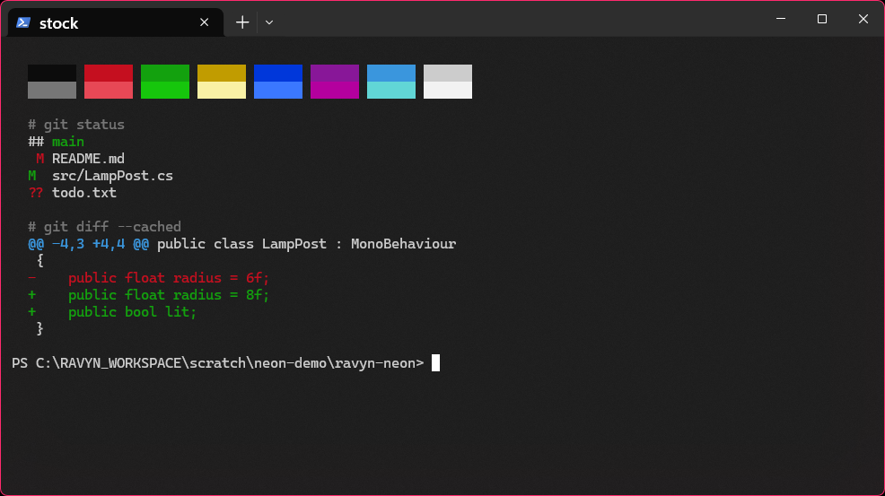
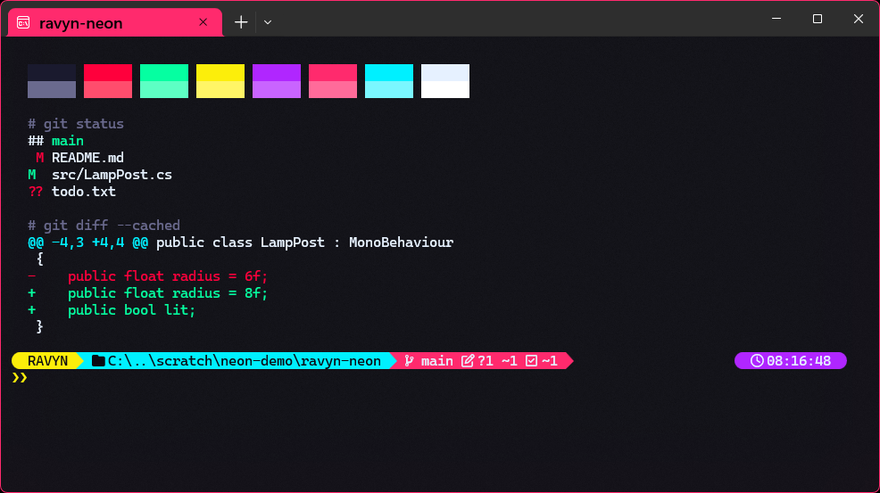
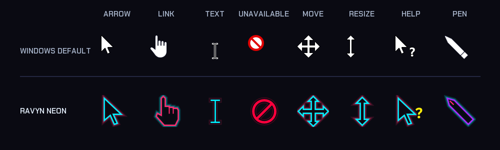
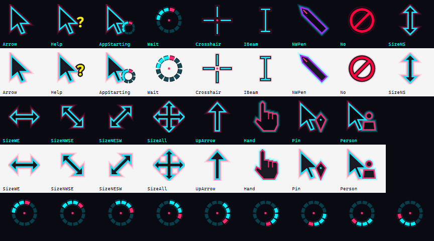

# RAVYN NEON

One neon palette for a Windows desktop: a Windows Terminal scheme, an Oh My Posh prompt, a cursor set and a Seelen UI theme.

<p>
  
  
</p>

Left: stock Windows Terminal. Right: RAVYN Neon with the prompt. Same window, same commands.



## Palette

| | Normal | Bright |
|---|---|---|
| Background | `#0A0A12` | |
| Foreground | `#E6F1FF` | `#FFFFFF` |
| Black | `#1A1A2E` | `#6A6A8E` |
| Red | `#FF003C` | `#FF4D6D` |
| Green | `#05FFA1` | `#5DFFC4` |
| Yellow | `#FCEE0A` | `#FFF566` |
| Blue | `#B026FF` | `#C964FF` |
| Purple | `#FF2A6D` | `#FF6B9A` |
| Cyan | `#00F0FF` | `#7AF7FF` |

## Install

Each part works on its own. Take what you want.

### Windows Terminal

1. Open Settings, then **Open JSON file**.
2. Paste the contents of [`windows-terminal/ravyn-neon.json`](windows-terminal/ravyn-neon.json) into the `"schemes"` array.
3. Set `"colorScheme": "RAVYN Neon"` on a profile, or under `"profiles" > "defaults"` for all of them.

### Oh My Posh prompt

Needs [Oh My Posh](https://ohmyposh.dev) and a [Nerd Font](https://www.nerdfonts.com) set as the terminal font. The screenshots use CaskaydiaCove Nerd Font.

Add this line to your PowerShell profile (`notepad $PROFILE`), with the path to where you saved the file:

```powershell
oh-my-posh init pwsh --config "C:\path\to\ravyn-neon.omp.json" | Invoke-Expression
```

### Cursors

Put the `cursors` folder somewhere permanent, then run:

```powershell
powershell -ExecutionPolicy Bypass -File .\cursors\install.ps1
```

It points the current user's cursors at the files in that folder. Add `-WhatIf` to see what it would change first. To undo, pick **Windows Default** under Settings > Bluetooth & devices > Mouse > Additional mouse settings > Pointers.

The whole set, on dark and light:



The cursors are drawn by code. `cursors/src/make-cursors.ps1` regenerates every `.cur` and `.ani` file and the preview sheet.

### Seelen UI

1. Copy [`seelen/RAVYN-Neon-HUD`](seelen/RAVYN-Neon-HUD) into `%APPDATA%\com.seelen.seelen-ui\themes\`.
2. Open Seelen UI settings, go to Themes, and enable **RAVYN Neon HUD**.

It restyles the toolbar, dock, window borders, task switcher and tooltips.

## Licence

[MIT](LICENSE). Every file here was made for this theme.
